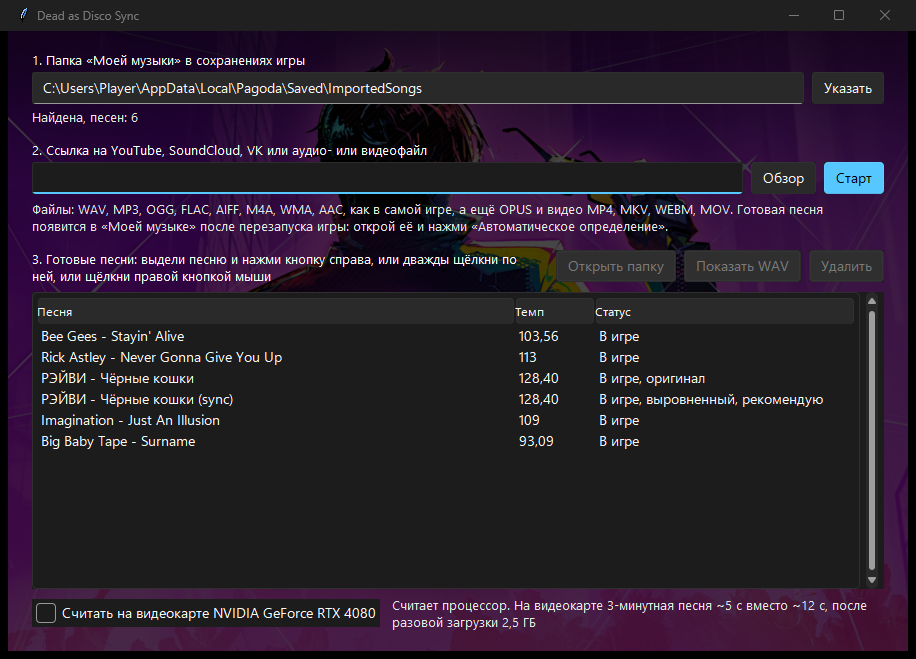

# Dead as Disco Sync

Your own music in Dead as Disco without manual setup: a link or a file becomes a track 
that starts exactly on a beat and is already in My Music.

**[Download DeadAsDiscoSync.bat](https://github.com/flipasd-108/dead-as-disco-sync/releases/latest/download/DeadAsDiscoSync.bat)** · [Русский](README.md)

The window follows the Windows language; on a non-Russian Windows it's in English.

## How to use

1. Download **[DeadAsDiscoSync.bat](https://github.com/flipasd-108/dead-as-disco-sync/releases/latest/download/DeadAsDiscoSync.bat)** into its own folder: a `songs` folder with the finished songs appears next to it.
2. Run it. The first run installs [uv](https://github.com/astral-sh/uv), Python, libraries and models: about 1 GB, a few minutes. Keep the black console window open meanwhile.
3. In the window check step 1, the My Music folder in the game's saves. It's usually found automatically; otherwise press Pick.
4. Paste a link or pick a file and press Start. You can add more links while one is analysed: they wait in a queue. You can also drop a file onto the window or onto DeadAsDiscoSync.bat.
5. Restart the game: the song is in My Music with its tempo and offset already set. No need to press Auto-detect: the tool writes the same numbers it would.

YouTube titles lose tails like "(Official Video)" and "[4K]". Finished songs collect in a list. The buttons above it open the song's folder in the game, show its WAV in Explorer and delete the song from the list, the game and the disk after a confirmation.

A 3-minute song takes about 12 s, about 40 s with a drifting tempo, plus the YouTube download.

## Requirements

- Windows 10 or 11.
- Internet on the first start (it downloads about 1 GB) and for links. On every start the .bat fetches the latest version from GitHub; without internet it runs the last one it downloaded.
- About 1 GB of disk space.
- Dead as Disco on the same PC, with at least one song already imported through the game. Otherwise the tool makes the WAV, but you add it to the game by hand.
- A graphics card is optional. With an NVIDIA card it can run faster, see [below](#graphics-card).

Links work from any site [yt-dlp](https://github.com/yt-dlp/yt-dlp) knows: YouTube, SoundCloud, Bandcamp, VK and more. Spotify and Yandex Music don't. Files: WAV, MP3, OGG, FLAC, AIFF, M4A, WMA, AAC (the game takes these too), plus OPUS and MP4, MKV, WEBM, MOV video.

DeadAsDiscoSync.bat is the only download; it installs the rest. If you used a version before 1.6, download the .bat again: the old one opens a console instead of the window.

## Troubleshooting

**Windows warns about a downloaded file.** The .bat comes from the internet and isn't signed, so Windows may ask whether to run it. Allow it. Open it in Notepad to see what it does: it's 18 lines.

**The song isn't in the game.** Restart the game: Reload Directory doesn't pick up new songs. If it's still missing, check step 1 in the window: the folder must be found. Last resort: add the WAV from the `songs` folder to the game by hand (the Show WAV button). It's trimmed to the beat, the source MP3 isn't.

**Hits land off the beat.** Press Auto-detect in the game, or enter the tempo from the tool's song list by hand. If a song has two versions, `(sync)` plays steadier: the drifting tempo of live drums is evened out in it.

**YouTube asks to confirm you're not a bot.** The tool retries and tries your Firefox YouTube sign-in. If that fails:

- sign in to YouTube in Firefox and run again;
- or install the "Get cookies.txt LOCALLY" Chrome extension, press Export on youtube.com and put `cookies.txt` next to DeadAsDiscoSync.bat;
- or download the song yourself and pick the file.

**Nothing helped.** Open an [issue](https://github.com/flipasd-108/dead-as-disco-sync/issues) and attach `songs\disco_sync.log`: it has everything the tool did and the error text.

**Your own `disco_sync.py` next to the .bat.** The .bat then runs it instead of the latest version. That's for development only; a regular user has no such file.

## Graphics card

With an NVIDIA card the tool offers to use it on the first start.

|                            | CPU   | GPU (measured on an RTX 4080) |
| -------------------------- | ----- | ----------------------------- |
| Regular 3-minute song      | ~12 s | ~5 s                          |
| Song with a drifting tempo | ~37 s | ~30 s                         |
| One-time download          | —     | ~2.5 GB more                  |
| Disk                       | ~1 GB | ~4 GB more                    |

The switch under the song list turns it on or off after a restart of the tool. AMD and Intel cards aren't supported; with them the tool runs on the CPU.

The window's background is game art, fetched on the first start into `songs\background.png`. Put your own `background.png` or `background.jpg` there to replace it.

## How it works

The developers said in an [80.lv interview](https://80.lv/articles/interview-how-dead-as-disco-synchronizes-combat-to-player-uploaded-music) that the game needs the tempo and a track cut to start on a beat. That's the track the tool prepares.

- Three independently trained [Beat This!](https://github.com/CPJKU/beat_this) models (CPJKU, 2024) find the beats. A least-squares grid through them gives the tempo to 0.01 BPM.
- The first beat is placed by the models' votes plus a vote from drum attacks: the attacks win when they agree with the models within 12 ms, otherwise the models' median does.
- The WAV is cut to that beat, or padded with silence back to the previous beat when there are pickup notes, so Start Time is always 0 and Beat Offset is the few ms the game's grid sits from the file start. A grid a few ms early is written as almost a whole beat: at 93 BPM, −3 ms shows as 642.
- If the tempo drifts more than 20 ms (a live drummer), you get two versions: the original and a `(sync)` copy stretched or squeezed by 1–2% between beats so the whole song runs at one tempo. Both go into the game.
- The game's Auto-detect is the same Beat This model 1 with a constant grid (the game's log loads a BeatThis plugin). On three songs the game's tempo and offset matched it within 0.0006 BPM and 0.5 ms. So the tool runs that model on the finished file and writes its tempo and offset into the game: the same result as pressing Auto-detect.
- A song goes into the game the way the game's own import puts it: a folder with an `Audio` file and `Meta.json` in `%LOCALAPPDATA%\Pagoda\Saved\ImportedSongs`. Other songs are never touched.

## For developers

- Without the window: `uv run disco_sync.py "<link or file>" [folder]`. Self-test: `uv run disco_sync.py --test`.
- Everything is in `disco_sync.py`, with its dependencies inline ([PEP 723](https://peps.python.org/pep-0723/)), pinned except yt-dlp, which YouTube keeps breaking.
- Every push to main runs the self-test on GitHub Actions; a release is built from a tag: `git tag -a v1.8 -F notes.md && git push origin v1.8`. It runs the self-test, builds `disco_sync_gpu.py` (`tools/make_gpu.py`: the same code with torch from the PyTorch CUDA index) and attaches `DeadAsDiscoSync.bat` (that's `run.bat`), `disco_sync.py` and `disco_sync_gpu.py`. The tag message becomes the release notes.
- Scenarios and the window's layout, in Russian: [PRODUCT.md](PRODUCT.md), [DESIGN.md](DESIGN.md).

## Credits

Idea and field format: [Aoshi2020/DeadAsDisco-SyncTool](https://github.com/Aoshi2020/DeadAsDisco-SyncTool). Beat tracking: [Beat This!](https://github.com/CPJKU/beat_this). Downloads: [yt-dlp](https://github.com/yt-dlp/yt-dlp). Window theme: [Sun Valley](https://github.com/rdbende/Sun-Valley-ttk-theme).

[MIT](LICENSE) licence. Dead as Disco and its art belong to Brain Jar Games; this tool isn't affiliated with them.
